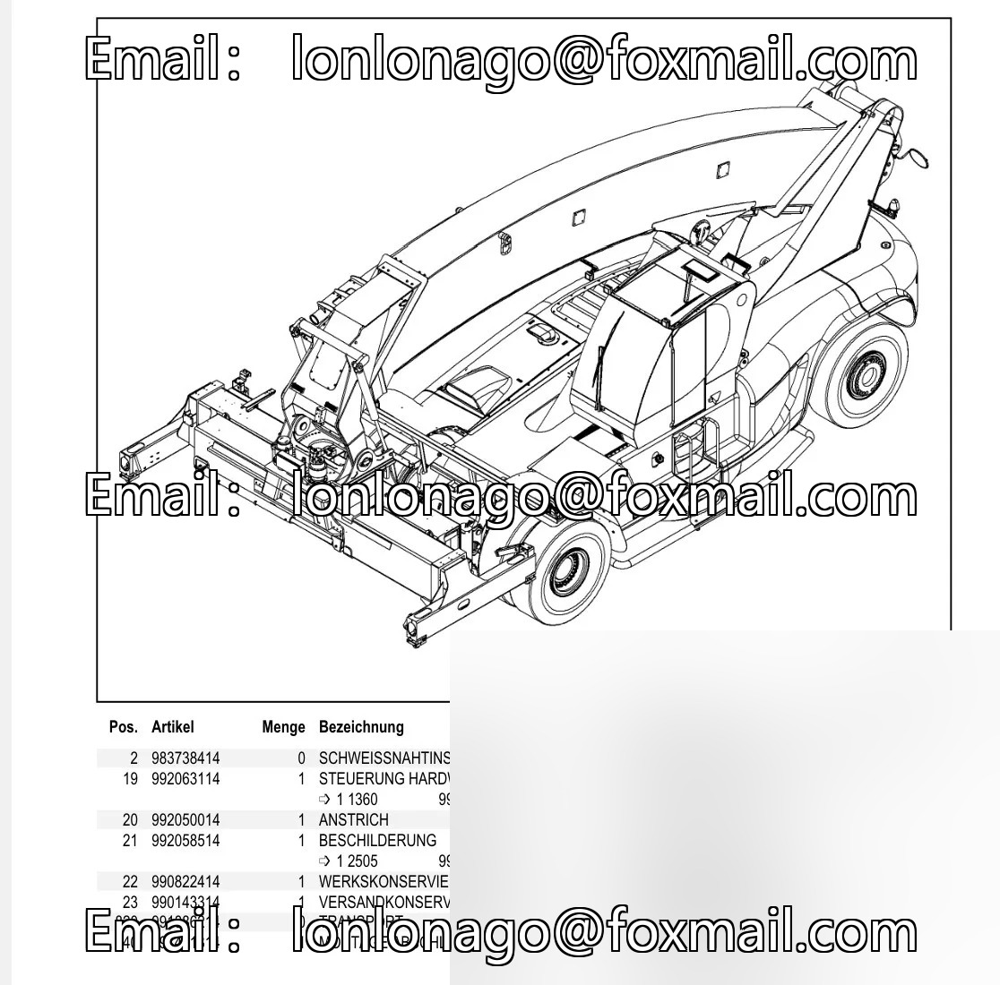
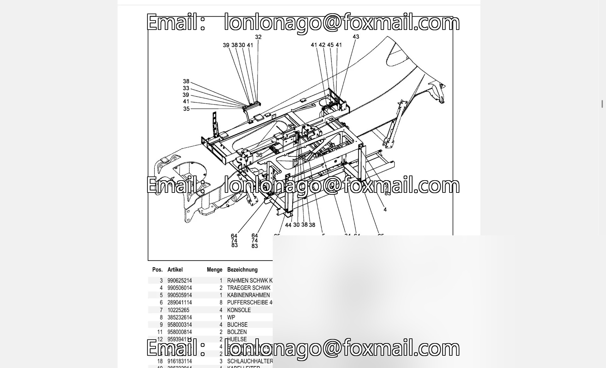
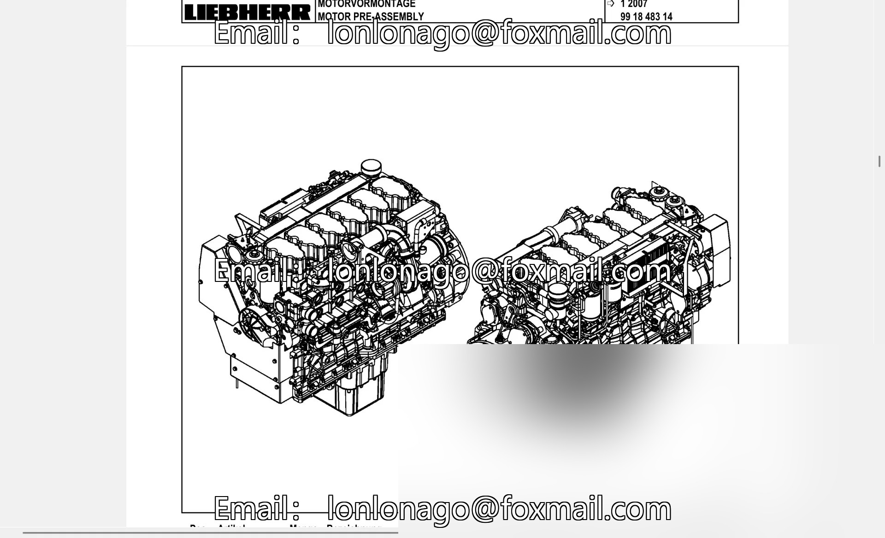

# Liebherr (LRS 645) flat container crane

## Body

Liebherr (LRS 645) container front hoist (or wood front hoist) parts catalog.

LRS 645 belongs to Libhart's classicforward lifting series, featuring a unique hook design, mainly used for port container stacking or large timber handling. Its 645 model usually represents its maximum lifting capacity or performance grade.

PDF , 350 pages,
373970679-18514

The Liebherr LRS 645 container frontloader features a curved arm design, includes a parts catalog, and has PDF documentation for port stacking or large timber handling.

<!-- AI_ENRICHED -->

## Images

## Payment

Here is a pay link on Stripe ( https://buy.stripe.com/3cs8yP7sY87d0vu9AB ). Please contact me lonlonago@foxmail.com after funding $89, and I will send you a complete data files , thank you!

